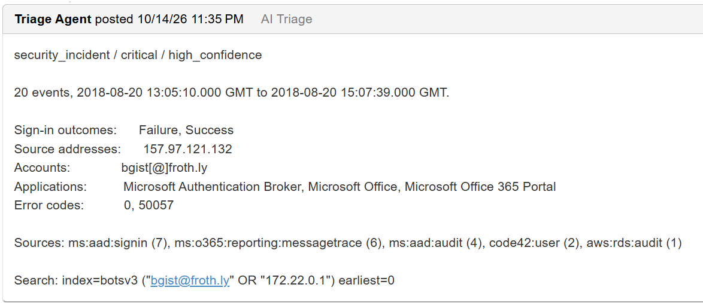
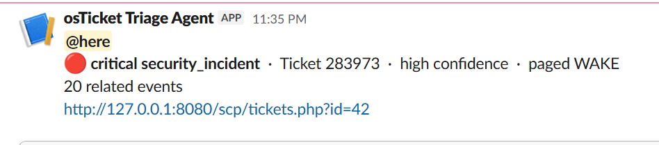
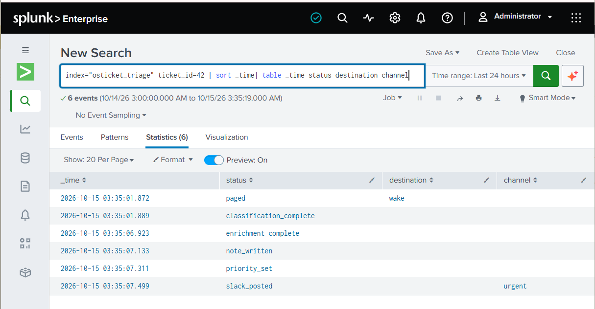
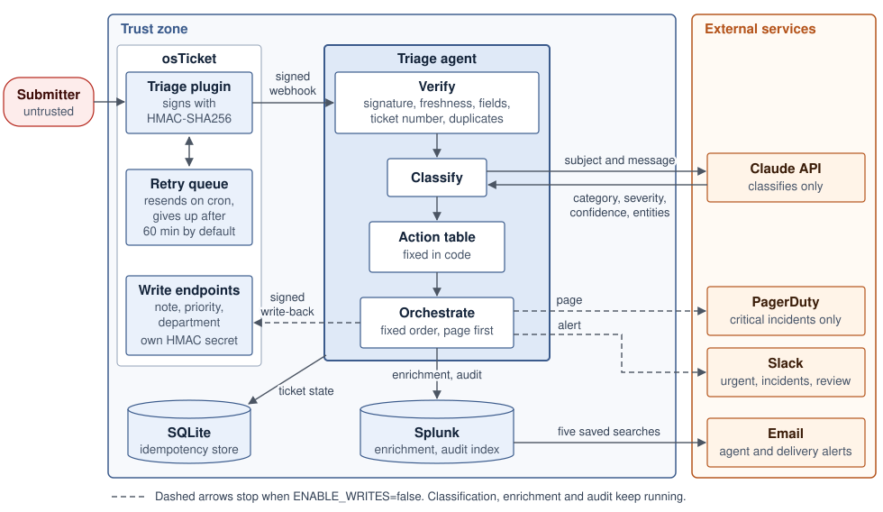

# osTicket AI Triage Agent

[](LICENSE)
[](https://github.com/umujalloh/osticket-triage-agent/actions/workflows/verify.yml)

**An AI triage layer for osTicket. Claude classifies incoming tickets, a fixed
action table decides what happens, and Splunk keeps the audit trail. Its job is
to keep real security incidents from getting buried in helpdesk noise.**

**Stack:** Python, FastAPI, Claude API, PHP, osTicket, Splunk, Docker, Slack,
PagerDuty

Built by Umu Jalloh · CompTIA Security+, Network+, AWS Certified Solutions
Architect Associate · Cybersecurity and Computer Forensics, Stark State College

## What it does

Helpdesk queues mix routine IT requests with early signals of real security
incidents. A compromised account or a phishing report can sit unread behind
printer tickets.

The agent sends each new ticket to Claude as it arrives and acts on the
classification Claude returns, following the
[action table](docs/action-table.md):

- A critical security incident pages the on-call through PagerDuty, posts to
  the urgent Slack channel, and its note lists any related events found in
  Splunk.
- Other security incidents post to the incidents Slack channel.
- Security questions move to the security department.
- Unclear tickets, and questions or IT support tickets Claude is unsure about,
  go to the review Slack channel.
- Routine IT support tickets stay in the osTicket department they were filed
  in, with no alert.

The agent also writes an internal note and sets a priority on every classified
ticket in osTicket, so by the time a responder opens the ticket, it has already
been triaged.

## A triaged ticket

On 2026-10-14 a signed-in user filed ticket 283973, reporting an intruder still
in their account. Claude labeled it
`security_incident / critical / high_confidence`. The agent paged the on-call
through PagerDuty, wrote an internal note on the ticket in osTicket, set its
priority to emergency, and alerted the urgent Slack channel with `@here`.

**The note on the ticket:** It gives the responder the Splunk enrichment, which
groups related events by field and shows the search that found them. The search
uses only the verified requester and the submitter IP. In this lab, Splunk
holds BOTSv3, a public training dataset built around a fictional company, so the
events date from 2018. Values copied from the logs are defanged so they cannot
become links. The linked address on the Search line is the verified requester's
own. Only staff can see the note.



**The Slack alert:** It tells the Slack channel what the agent decided, where
it paged and how many events turned up, with a link to the ticket.



**The audit index:** Splunk records each step of this ticket's triage, so how
it was handled can be reconstructed later. The page comes first, ahead of every
call to Splunk, so a slow Splunk cannot hold up the pager. Times are in UTC,
so the run shows as early on 2026-10-15.



## How it works



The plugin signs each new ticket and sends it to the agent, which verifies it,
has Claude classify it, looks up the label's row in
[`action_table.py`](agent/action_table.py) and carries out the actions it maps
to. osTicket, the agent and Splunk run inside the trust zone, on the
deployment's own infrastructure. Claude, Slack, PagerDuty and the alert email
sit outside it.

Claude returns a label and any hostname, username or IP the ticket names. It
never writes, never builds a query and never picks an action, so a manipulated
label can only trigger a different set of actions the table already defines.
The worst it can do is keep an incident quiet, as when one labeled `it_support`
at high confidence alerts no one, or page the on-call for nothing.

## Security

These are the main controls. The
[threat model](docs/architecture.md#4-threat-model) covers eight attacks on the
design, each with its defense and the risk that remains.

- **The webhook accepts only signed, fresh requests for real tickets.** It
  checks an HMAC-SHA256 signature in constant time, refuses a request more than
  five minutes old or with malformed fields, confirms the ticket number with
  osTicket, and refuses a ticket it has already finished.
  [Threat model, Attack 7](docs/architecture.md#attack-7-replay-and-duplicate-processing)
- **Prompt injection is contained to Claude's answer.** The subject and message
  go to Claude in the user role inside a delimiter that is random per request,
  so a ticket cannot predict the delimiter to close it and pass as
  instructions. The answer is forced through a tool schema and validated again
  with Pydantic. A ticket worded to mislead can still get a wrong label.
  [Threat model, Attack 1](docs/architecture.md#attack-1-prompt-injection)
- **The submitter cannot choose what Splunk searches.** Enrichment runs one
  fixed query on the submitter IP osTicket observed, and on the requester's
  email only when osTicket authenticated that requester. Values Claude extracts
  from the ticket are never searched. A ticket therefore cannot point the search
  at someone else's activity, as long as osTicket's session handling holds and
  its trusted proxy setting lists only the deployment's own proxies.
  [Threat model, Attack 3](docs/architecture.md#attack-3-indirect-data-exfiltration-via-internal-notes)
- **Requester details and Splunk events stay inside the trust zone.** The
  requester's email and IP and the events Splunk returns never reach Claude,
  Slack or PagerDuty. Alerts and pages are built from what the agent decided and
  did, the ticket number and a link, and carry nothing the submitter wrote.
  [Architecture, section 8](docs/architecture.md#what-leaves-the-zone)
- **Most credentials follow least privilege.** The webhook and the write-back
  use separate secrets, so the webhook secret cannot write to a ticket
  directly. Splunk access is split into a read-only search role on one index
  and a token that can add audit events but not read them. The exceptions are
  the Claude API key, which an attacker could use to run up the bill, and the
  read-only PagerDuty REST API key, which reaches the whole PagerDuty account.
  [Architecture, section 8](docs/architecture.md#credentials)
- **A kill switch stops every ticket change, alert and page the agent makes.**
  `ENABLE_WRITES` has no default and accepts only `true` or `false`, so a typo
  stops the agent at boot. With it off, the agent still classifies, enriches
  and writes its audit log, so it can run against real tickets with nothing
  delivered.
  [Architecture, section 7](docs/architecture.md#kill-switch)

## Failure handling

- **A ticket Claude cannot classify goes to the review Slack channel.** The
  agent posts it there with the failure type and assigns no classification,
  because a guessed one could quietly mark an incident as routine.
  [Architecture, section 6](docs/architecture.md#6-failure-modes-for-the-claude-dependency)
- **A ticket the agent does not accept is flagged, then retried.** The plugin
  notes on the ticket that triage has not run, so nobody reads its priority as
  a triage decision, and retries it for an hour by default, on osTicket's cron
  and after the next ticket that gets through. If delivery never succeeds, the
  note says triage never ran.
  [Architecture, section 7](docs/architecture.md#when-the-agent-is-unreachable)
- **An interrupted ticket is finished on the next start.** The agent keeps the
  request in its SQLite idempotency store until every action is done, with a
  flag for each one, so a restart runs only the actions still owed. A ticket
  more than an hour old, by default, goes to the review Slack channel instead,
  since a page about something hours old would mislead.
  [Architecture, section 7](docs/architecture.md#idempotency)
- **A missing audit record is noted on the ticket.** If the classification
  never reaches Splunk, the agent ends the note with `No audit record.`, so the
  gap shows where the ticket is worked.
  [Architecture, section 9](docs/architecture.md#the-audit-record)
- **Five Splunk searches email when the agent or its delivery fails.** They
  fire when the agent stops reporting, keeps restarting, keeps failing to post
  to Slack or page PagerDuty, or finds a PagerDuty routing key dead or
  unchecked. All five run in Splunk and send through one mail account, so a
  Splunk outage or a broken mail setup can silence them.
  [Architecture, section 9](docs/architecture.md#watching-the-agent)

## How it was tested

The classifier is scored against 36 hand-written, labeled tickets, most
recently on 2026-10-13 with `claude-haiku-4-5`. The score is a regression check
on these tickets and does not estimate accuracy on real ones.

Verifiers are scripts that each test one part of the built system from a
single command.

| Check | Result |
|---|---|
| [Classifier evaluation](docs/evaluation.md), nine runs | 35 of 36 in every run, no [danger failures](docs/evaluation.md#the-danger-criterion) |
| [Live verifiers](docs/verification.md), run by hand because they need the stack or send real alerts | 170 checks across 5 verifiers, all passing |
| [Offline verifiers](docs/verification.md), run in CI on every push | 228 checks across 9 verifiers, all passing |

## Documentation

| Document | What it covers |
|---|---|
| [Architecture](docs/architecture.md) | Design, threat model, trust boundaries and deployment preconditions |
| [Action table](docs/action-table.md) | The contract between a classification and the actions the agent takes, with the reasoning for each row |
| [Verification](docs/verification.md) | How each part of the built system was tested, with the method, the result and how to reproduce it |
| [Evaluation](docs/evaluation.md) | How the classifier is scored, its latest results, and the rule a prompt change must pass |
| [Known limitations](docs/known-limitations.md) | What this build cannot do, and why each limit stands |
| [Setup](docs/setup.md) | Running the stack, from an empty directory to a triaged ticket |

## Repository layout

```
agent/                The triage agent, a FastAPI service. Start at main.py,
                      which receives the webhook and takes each ticket from
                      classification to its actions. Each other module is
                      named for its one job
agent/verification/   14 verifiers, each run from one command
osticket-plugin/      The PHP plugin: signing, delivery, retries, write-back
docker/               The Compose stack, Splunk setup and saved searches
docs/                 The six documents above, and the README's images
eval/                 The labeled tickets the classifier is scored against
.github/workflows/    CI that runs the offline verifiers on every push
```
